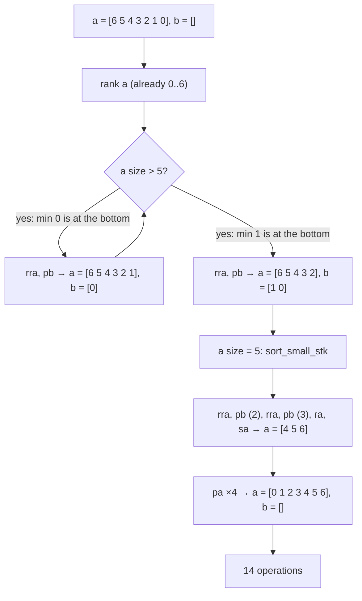
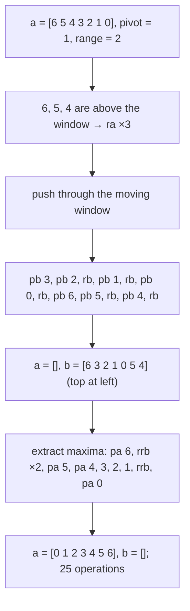
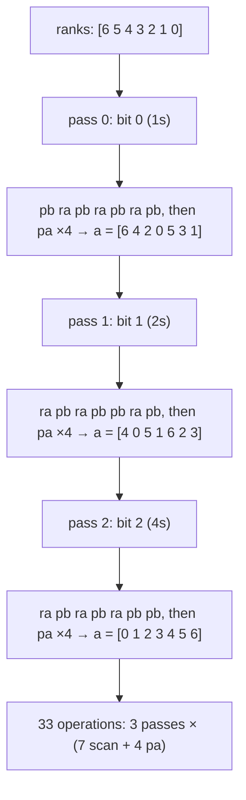
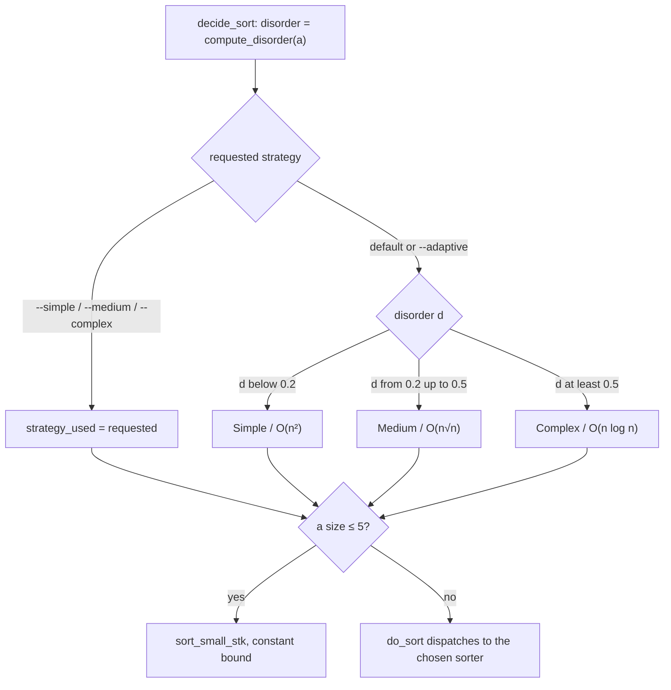
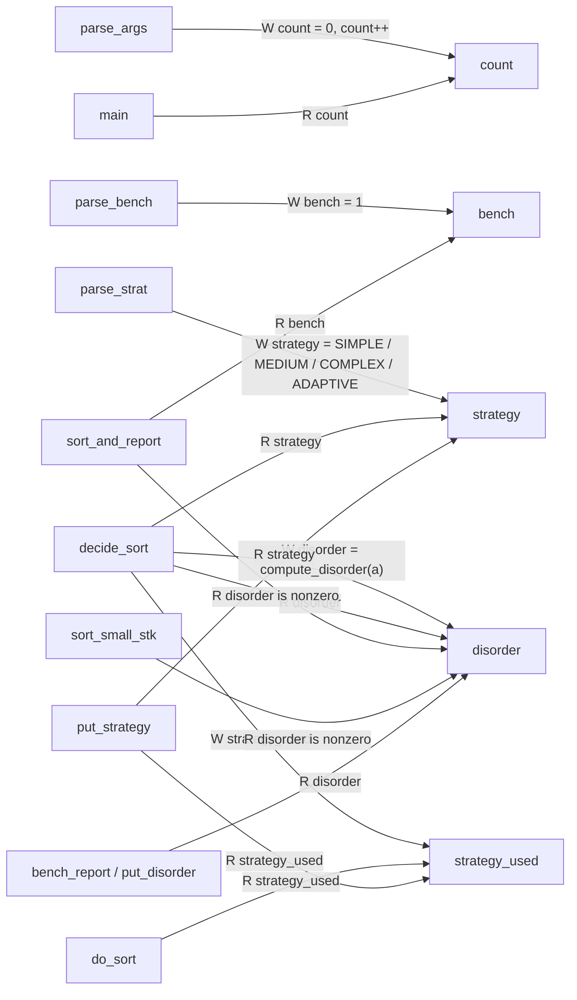

*This project has been created as part of the 42 curriculum by stelchen, slau.*

# push_swap

## Description

`push_swap` sorts a list of distinct integers using two stacks and only the eleven
Push_swap operations. The goal is not merely to sort correctly, but to emit the
smallest operation sequence possible and to understand how the operation count grows
with the input size.

The program:

- reads stack `a` from the command line, first argument on top;
- ranks the values so that only their relative order matters;
- measures **disorder** with the subject's inversion-pair metric;
- selects one of four strategies:
  - **Simple** — `O(n²)` minimum extraction;
  - **Medium** — `O(n√n)` moving rank-window sort;
  - **Complex** — `O(n log n)` binary LSD radix sort;
  - **Adaptive** — chooses Simple, Medium, or Complex from the measured disorder;
- writes the operation stream to **stdout**;
- optionally writes a benchmark report to **stderr**;
- reports malformed input as `Error\n` on **stderr** with a non-zero exit status.

The implementation is split into small units with a single public header,
`push_swap.h`. Every operation mutates a stack through the same output sink, so
printing, silent execution, and benchmark counting cannot drift apart.

## Team and contributions

This is a two-learner group project. Both learners reviewed and can explain every
strategy and every operation.

| 42 login | Name | Primary contributions |
| --- | --- | --- |
| `stelchen` | Stella Chen | Number parsing and flag handling, `t_metadata` plumbing, disorder metric, rank conversion, small-stack sorting, TST test suites, parser/error edge cases. |
| `slau` | Simon Lau | Stack and operation layer (`op_emit` / `stats_record`), Simple/Medium/Complex strategies, adaptive dispatch, benchmark reporting, Makefile, CLI integration tests. |
| both | — | Algorithm design reviews, debugging, performance measurement, cross-checking operation streams with independent stack simulators, and this documentation. |

The repository history contains commits from both learners across the shared files.
The table above lists primary ownership, not exclusive authorship.

## The Push_swap model

Two stacks are manipulated by eleven operations. Index `0` is the top of a stack;
the stack backing store is a contiguous `int` array.

| Operation | Effect |
| --- | --- |
| `sa` / `sb` / `ss` | Swap the top two elements of `a` / `b` / both. |
| `pa` / `pb` | Push the top of `b` onto `a` / the top of `a` onto `b`. |
| `ra` / `rb` / `rr` | Rotate a stack upward: first element becomes last. |
| `rra` / `rrb` / `rrr` | Reverse-rotate: last element becomes first. |

Operations are only meaningful when the stack has the required elements; on a short
stack the mutation is a safe no-op, and a push that cannot happen emits nothing. Each
operation calls `op_emit`, which records the operation in `t_out` through
`stats_record` and then writes its name unless the context is silent
(`out->fd < 0`).

### Disorder metric

`compute_disorder` compares every pair of values in stack `a`:

```text
mistakes / total_pairs, where a pair (i, j), i < j, is a mistake when a[i] > a[j]
```

- `0.00` means stack `a` is already sorted.
- `1.00` means it is in reverse order.
- A uniformly random permutation has an expected disorder near `0.50`.

The computation is `O(n²)` comparisons and `O(1)` extra space. It emits no
Push_swap operations, so it does not count toward the operation-complexity claims,
but it is part of the program's CPU time.

## Instructions

### Requirements

- A C compiler available as `cc` (C code in 42 Norm style).
- `make`.
- A POSIX shell for the test loops.
- The bundled `ft_printf`/`libft` sources in `ft_printf/`; no external library is
  required.

### Build

```sh
make          # builds ./push_swap
make bonus    # builds ./checker from the bonus sources
make re       # fclean + all
```

The build uses `-Wall -Wextra -Werror`; the project is warning-free with those
flags.

### Run

```sh
./push_swap 2 1 3 6 5 8
./push_swap --simple 5 4 3 2 1
./push_swap --medium 4 67 3 87 23 12
./push_swap --complex 4 67 3 87 23 12
./push_swap --adaptive 4 67 3 87 23 12
```

Strategy flags:

| Flag | Behaviour |
| --- | --- |
| `--simple` | Force the `O(n²)` minimum-extraction strategy. |
| `--medium` | Force the `O(n√n)` moving-window strategy. |
| `--complex` | Force the `O(n log n)` binary radix strategy. |
| `--adaptive` | Select from disorder; this is the default when no strategy flag is given. |

Flags must appear **before** the integers. `--bench` and one strategy flag may be
written in either order and are both consumed before the numbers.

### Benchmark mode

```sh
./push_swap --bench --complex 4 67 3 87 23 12 > /dev/null
```

The operation stream still goes to stdout; the report goes to stderr:

```text
[bench] disorder: 46.67%
[bench] strategy: Complex / O(n log n)
[bench] total_ops: 29
[bench] sa: 0 sb: 0 ss: 0 pa: 11 pb: 11
[bench] ra: 7 rb: 0 rr: 0 rra: 0 rrb: 0 rrr: 0
```

The report contains the disorder percentage with two decimals, the requested
strategy, the concrete strategy used by an adaptive run, the total operation count,
and the count of each of the eleven operations.

### Error handling

Invalid arguments produce `Error\n` on stderr and a non-zero exit status. This
includes non-numeric arguments, values outside `int` range, duplicate values, and
empty numeric input.

```sh
$ ./push_swap --adaptive 0 one 2 3
Error
$ ./push_swap --simple 3 2 3
Error
```

With no arguments, the program prints nothing and returns a failure status.

### Tests

```sh
make test        # mandatory suites, built with ASan/UBSan
make test-bonus  # bonus-side suites
make testparser  # focused parser suite
```

Suites are auto-discovered from `tests/test_*.c`; `_bonus` suites are reserved for
`make test-bonus`. The suites cover parsing and flags, stack allocation, all
operations, operation counters, disorder, ranking, the three sorters, the small-stack
helpers, benchmark formatting, and an end-to-end CLI test that verifies stdout,
stderr, and exit status.

### Bonus checker status

`make bonus` builds `./checker`, and `checker_ops_bonus.c` implements and tests the
instruction dispatch table. The stdin read loop and the final `OK`/`KO` driver in
`checker_bonus.c` are still a stub in this revision. The mandatory `push_swap`
binary is complete and does not depend on the checker.

## Strategy overview

| Strategy | Flag | Core idea | Emitted-operation bound | Extra space |
| --- | --- | --- | --- | --- |
| Simple | `--simple` | Repeatedly extract the current minimum to `b`; finish a small `a`; push back. | `O(n²)` | `O(n)` |
| Medium | `--medium` | Push ranks through a sliding window of width `Θ(√n)`, then extract maxima from `b`. | `O(n√n)` | `O(n)` |
| Complex | `--complex` | Stable binary LSD radix passes over the ranks. | `O(n log n)` | `O(n)` |
| Adaptive | default / `--adaptive` | Measure disorder, then dispatch to Simple, Medium, or Complex. | regime bound below | `O(n)` |

Each concrete sorter first calls `rank_ints`, replacing the values by their ranks
`0 .. n-1`. Ranking is `O(n²)` comparisons and `O(n)` extra space, but it emits no
Push_swap operations. The operation bounds in this README are therefore counts of
**generated Push_swap operations**, exactly as the subject's complexity model
requires. The one-off ranking cost is stated separately so it is not hidden.

## Algorithms

### 1. Simple — `O(n²)`

Source: `sort_simple.c`, with `sort_small_utils.c` for the final five elements.

1. Rank stack `a`.
2. While `a` has more than five elements:
   - find the index of the minimum value;
   - rotate it to the top using the shorter direction (`ra` or `rra`);
   - push it to `b` with `pb`.
3. Sort the remaining at-most-five elements with a dedicated small-stack routine.
4. Push everything from `b` back to `a` with `pa`.

Because minima are pushed to `b` first, the smallest value ends up at the bottom of
`b` and later minima sit above it. Pushing back therefore places the largest
extracted value first and the smallest last, which leaves `a` in ascending order.



Actual operation stream for this input:

```text
rra pb rra pb rra pb rra pb ra sa pa pa pa pa
```

**Why `O(n²)` operations.** There are `n` extractions. Finding the minimum is a
linear scan, and bringing it to the top costs at most `n/2` rotations, so the
extraction loop emits `O(n²)` rotations and pushes in the worst case. The final
`pa` pass is `O(n)`, and the small-stack routine touches at most five elements, so
it is `O(1)`. The two stacks and the rank array occupy `O(n)` space.

### 2. Medium — `O(n√n)`

Source: `sort_medium.c`.

The ranks are partitioned by a moving value window rather than by fixed value
ranges:

1. Rank stack `a`.
2. Set `pivot = floor(1.4 · √n / 2)` and `range = floor(1.4 · √n)`.
3. While `a` is non-empty, inspect its top:
   - if `top ≤ pivot`: `pb` then `rb`, so this small value is buried at the bottom
     of `b`; then `pivot++`;
   - else if `top ≤ pivot + range`: `pb` without `rb`; then `pivot++`;
   - otherwise: `ra`, leaving the value for a later, higher window.
4. When `a` is empty, repeatedly find the maximum of `b`, rotate it to the top
   using the shorter direction, and `pa` it.
5. `b` becomes empty and `a` receives the values from largest to smallest, so the
   final stack is ascending.



Actual operation stream for this input:

```text
ra ra ra pb pb rb pb rb pb rb pb pb rb pb rb pa rrb rrb pa pa pa pa pa rrb pa
```

**Why `O(n√n)` operations.** Every element is pushed exactly once. The window has
width `Θ(√n)` and advances by one rank per push. View the ranks as `n/√n` blocks of
width `√n`. While the pivot crosses one block, at most `√n` new elements can become
pushable, and the rotations needed to find them amount to one traversal of the
stack plus the gaps between those elements: `O(n)` per block, hence `O(n√n)` for
the push phase. The pull phase extracts `n` elements with `pa` and rotates each
maximum to an end; the `rb` pushes have placed the smallest values at the bottom
and the larger values near the top, so these rotations stay within the same
`O(n√n)` bound. The stacks and rank array use `O(n)` space.

For reference, at `n = 500` the measured medium run used 500 `pb`, 500 `pa`,
1161 `ra`, 1763 `rb`, and 1802 `rrb`: the extraction rotations dominate the
constant but remain comfortably inside `n√n`.

### 3. Complex — `O(n log n)`

Source: `sort_complex.c`.

This is a stable binary LSD radix sort over the ranks:

1. Rank stack `a` to values `0 .. n-1`.
2. Compute the number of passes as the number of bits needed for `n`:
   `ceil(log2 n)`.
3. For each bit `k`, from least significant to most significant:
   - process exactly `n` elements from the top of `a`:
     - bit `k` is `0`: `pb`;
     - bit `k` is `1`: `ra`;
   - push every element of `b` back to `a` with `pa`.
4. After the last pass, `a` is sorted ascending and `b` is empty.

The scan is a stable partition. The zeros are pushed to `b`, the ones are rotated
to the back, and the `pa` pass returns the zeros to the top in their original
relative order. Repeating this for increasing bit positions is exactly LSD radix
sort.



**Why `O(n log n)` operations.** There are `ceil(log2 n)` passes. Each pass performs
exactly `n` scan operations (every element is either `pb` or `ra`) plus at most `n`
`pa` operations while emptying `b`. The total is at most
`2n · ceil(log2 n) = O(n log n)`. The operation count is independent of the input
permutation. The two stacks and rank array use `O(n)` space.

### 4. Adaptive — default and `--adaptive`

Adaptive selection lives in `decide_sort` in `main.c`; `sort_adaptive.c` is a
reserved entry point and currently contains no sorting logic. `decide_sort` is the
single place that turns a requested strategy and a measured disorder into the
concrete strategy that runs.

| Disorder `d` | Internal method | Target class |
| --- | --- | --- |
| `d < 0.2` | Simple minimum extraction | `O(n²)` |
| `0.2 ≤ d < 0.5` | Medium moving window | `O(n√n)` |
| `d ≥ 0.5` | Complex binary radix | `O(n log n)` |



Example adaptive runs:

| Input | Disorder | Selected | Operations |
| --- | --- | --- | --- |
| `1 2 4 3 5 6 7` | `4.76%` | Simple | 10 |
| `4 67 3 87 23 12` | `46.67%` | Medium | 19 |
| `6 5 4 3 2 1 0` | `100.00%` | Complex | 33 |

**Rationale for the thresholds.** `0.2` and `0.5` are the subject's regime
boundaries and they match the strategy costs:

- below `0.2`, the list is close to sorted; only a few local inversions exist, so
  the `O(n²)` baseline has a small constant and avoids the overhead of radix
  passes;
- between `0.2` and `0.5`, the list is partly ordered; the moving-window sort wins
  because it exploits existing order without paying `O(n²)` rotation costs;
- at `0.5` and above the input behaves like a random or reverse-ordered list; the
  radix sorter gives a predictable `O(n log n)` worst case and ignores how messy
  the permutation is.

The adaptive run's complexity is the bound of the selected strategy. Measuring
disorder and choosing a branch costs `O(n²)` comparisons but emits no operations;
the `n ≤ 5` small-stack branch is constant.

## Performance

Measurements below are operation counts from five random permutations per size
(values sampled from `-100000 .. 100000`). Only the average and range are shown;
operation counts do not depend on compiler optimisation.

| `n` | `--simple` | `--medium` | `--complex` | default / `--adaptive` |
| --- | --- | --- | --- | --- |
| 100 | 1434 (1269–1533) | 692 (650–735) | 1084 | 777 (650–1084) |
| 500 | 32532 (31575–33214) | 6108 (5961–6217) | 6784 | 6108 (5961–6217) |

Subject targets:

| `n` | Pass | Good | Excellent |
| --- | --- | --- | --- |
| 100 | < 2000 | < 1500 | < 700 |
| 500 | < 12000 | < 8000 | < 5500 |

The default/adaptive path lands in the **good** band at both benchmark sizes and
sometimes reaches the excellent band at `n = 100` when the input disorder sends it
to Medium. Forced `--simple` is the baseline `O(n²)` strategy and is not expected
to meet the large-input targets. Forced `--medium` and `--complex` both meet the
`n = 500` good target.

## `t_metadata`: read/write map

`t_metadata` is the single value object that carries CLI configuration and the
measured metrics through the program. It is defined in `push_swap.h`:

```c
typedef struct s_metadata
{
    int   bench;          /* --bench was present */
    float disorder;       /* measured disorder of the original a */
    int   strategy;       /* requested strategy */
    int   strategy_used;  /* strategy actually dispatched */
    int   count;          /* number of integers parsed */
} t_metadata;
```

`main` owns the only production instance and zeroes it with `ft_bzero` before
parsing. The diagram shows the production readers and writers; test files also
set/read fields directly to assert behaviour.



### Field-by-field access table

| Field | Written by | Read by | Purpose |
| --- | --- | --- | --- |
| `bench` | `parse_bench` (`meta->bench = 1`) | `sort_and_report` (`if (metadata->bench)`) | Gate the stderr benchmark report. |
| `disorder` | `decide_sort` (`= compute_disorder(a)`) | `decide_sort` (thresholds), `sort_and_report` (`!= 0`), `sort_small_stk` (size-2 case), `bench_report`/`put_disorder` | Adaptive classification, skip sorting already-sorted input, size-2 decision, report percentage. |
| `strategy` | `parse_strat` (`= SIMPLE`, `MEDIUM`, `COMPLEX`, or `ADAPTIVE`) | `decide_sort` (`== ADAPTIVE`), `put_strategy` (`used = meta->strategy`) | Record and report the requested mode. |
| `strategy_used` | `decide_sort` (adaptive regime or `= strategy`) | `do_sort` (dispatch branches), `put_strategy` (adaptive sub-strategy label) | Identify the concrete sorter that ran. |
| `count` | `parse_args` (`= 0`, then post-increment per number) | `main` (`has_duplicates(data, metadata.count)`, `stack_init(..., metadata.count, ...)`) | Number of parsed integers; replaces the old `argc - 1` assumption. |

Notes:

- `main` zero-initialises every field, so `strategy == ADAPTIVE` is the default
  before any flag is parsed.
- `decide_sort` writes `disorder` and then reads it back for the threshold
  comparisons; it is the only production writer of `disorder`.
- `sort_simple` receives `metadata` only to forward it to `sort_small_stk`; the
  simple sorter itself does not read a field.
- `sort_medium` and `sort_complex` do not receive `t_metadata`.
- `bench_report` reads `strategy` first. When the requested strategy is
  `ADAPTIVE`, it switches to `strategy_used`; an out-of-range `strategy_used`
  falls back to the Complex label.
- `bench_counts` reads only `t_out`, not `t_metadata`.

## Repository layout

| Path | Contents |
| --- | --- |
| `push_swap.h` | Public API: stack, metadata, output and operation enums, prototypes. |
| `main.c` | CLI entry point, metadata ownership, adaptive strategy decision, dispatch, benchmark gate. |
| `parser.c` | Numeric parsing, overflow rejection, flag parsing, `count` maintenance. |
| `stack.c` | `t_stack` allocation and destruction. |
| `ops_*.c` | All eleven operations, the shared `op_emit` sink, and operation counters. |
| `sort_simple.c` | `O(n²)` minimum-extraction strategy. |
| `sort_medium.c` | `O(n√n)` moving-window strategy. |
| `sort_complex.c` | `O(n log n)` binary LSD radix strategy. |
| `sort_small_utils.c` | Constant-size sorts for one to five elements. |
| `sort_adaptive.c` | Reserved adaptive entry point; current decision logic is in `main.c`. |
| `compute_disorder.c` | Inversion-pair disorder metric. |
| `rank_ints.c` | Converts values to their ranks. |
| `find_idx_utils.c` | Min/max lookup and nearest-direction rotation. |
| `bench_report.c`, `bench_counts.c` | Stderr benchmark formatting. |
| `checker_*.c`, `checker_bonus.h` | Bonus checker sources (dispatch implemented; stdin driver still a stub). |
| `tests/` | TST suites and the `test.c`/`test.h` harness. |
| `raw/` | Dated source material collected while learning the topic. |
| `wiki/` | Distilled notes, with `index.md` and `log.md`. |
| `report/` | Internal review and architecture notes; not part of the binary. |

## Resources

### Subject and project notes

- [42 Push_swap subject, version 1.1](raw/push-swap-project.md) — the authoritative
  rules, disorder definition, strategy classes, benchmark targets, and README
  requirements.
- [Distilled project notes](wiki/push_swap.md) — a short knowledge-base summary.
- [Big-O notation](wiki/algorithms/big-o-notation.md) — formal definition and the
  complexity classes used in this README.
- [Binary radix sort](wiki/algorithms/binary-radix-sort.md) and
  [radix-sort complexity notes](raw/algorithms/2026-10-23-binary-radix-sort-complexity.md)
  — the basis for the Complex strategy.
- [Bucket sort](wiki/algorithms/bucket-sort.md) and
  [ranking notes](wiki/algorithms/rank-elements-array.md) — background for the
  Medium window and the shared rank preprocessing.
- [Command-line arguments in C](wiki/c-programming/command-line-arguments.md) —
  parsing background.
- [TST C testing framework](wiki/c-programming/tst-c-testing-framework.md) — the
  test harness used by `make test`.
- [Doxygen for C](wiki/c-programming/doxygen-cpp-documentation.md) — comment style
  used in several source files.
- Donald E. Knuth, *The Art of Computer Programming, Volume 1* — origin and
  discussion of asymptotic notation.
- Aditya Bhargava, *Grokking Algorithms* — accessible explanations of selection
  sort, radix sort, and Big-O.

### How AI was used

AI assistance was used for:

- drafting and formatting this README;
- generating the Mermaid diagrams from the actual implementation and then checking
  them against real `--bench` runs;
- code review and bug triage, captured in
  [`report/handoff-push-swap-review.md`](report/handoff-push-swap-review.md);
- scaffolding some TST test cases and suggesting edge cases for the parser, flags,
  and benchmark channel.

AI was **not** treated as an unreviewed source of algorithm logic. The authors
reviewed the generated suggestions, compiled every change with
`-Wall -Wextra -Werror`, ran the ASan/UBSan suites, and verified operation streams
with independent stack simulators. Content that did not match the source or the
subject was discarded. Both authors remain responsible for, and can explain, every
part of the submitted code.

## Known implementation notes

- **Small inputs.** `do_sort` takes a dedicated `sort_small_stk` path for
  `|a| ≤ 5` before consulting `strategy_used`. The output is always correct, but a
  forced strategy flag does not change the algorithm used for those tiny inputs;
  the bench label still reports the requested strategy.
- **Rank preprocessing.** Each concrete sorter calls `rank_ints` once. Its `O(n²)`
  comparisons are outside the emitted-operation complexity model, as discussed in
  the strategy sections.
- **Adaptive placement.** `decide_sort` in `main.c` is the adaptive implementation;
  `sort_adaptive.c` is a dormant entry point.
- **Flag position.** Flags are only recognised before the first integer. This keeps
  the parser deterministic: the first non-flag argument starts the numeric list.
- **Benchmark labels.** The report spells the medium class as `O(n*sqrt(n))` in
  ASCII because the project's output helpers only emit plain characters.
- **Bonus checker.** As noted under *Instructions*, `checker` builds and its
  instruction dispatcher is tested, but the stdin `OK`/`KO` driver is not finished.
