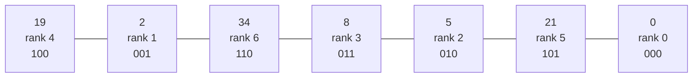
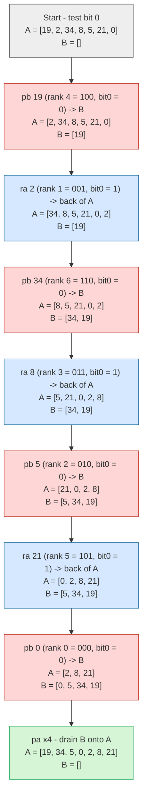
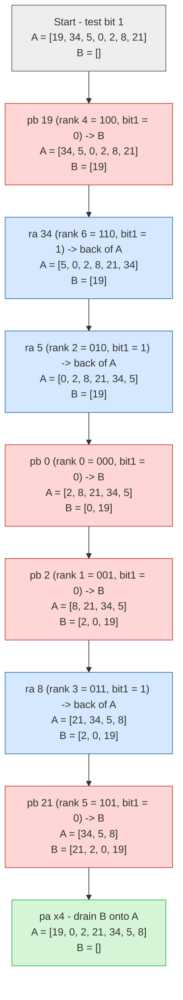
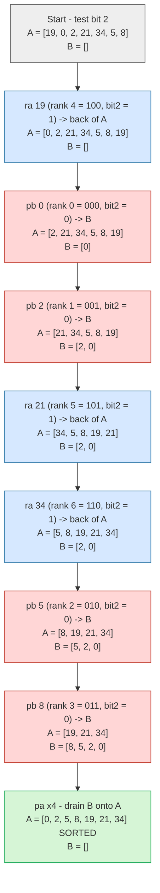
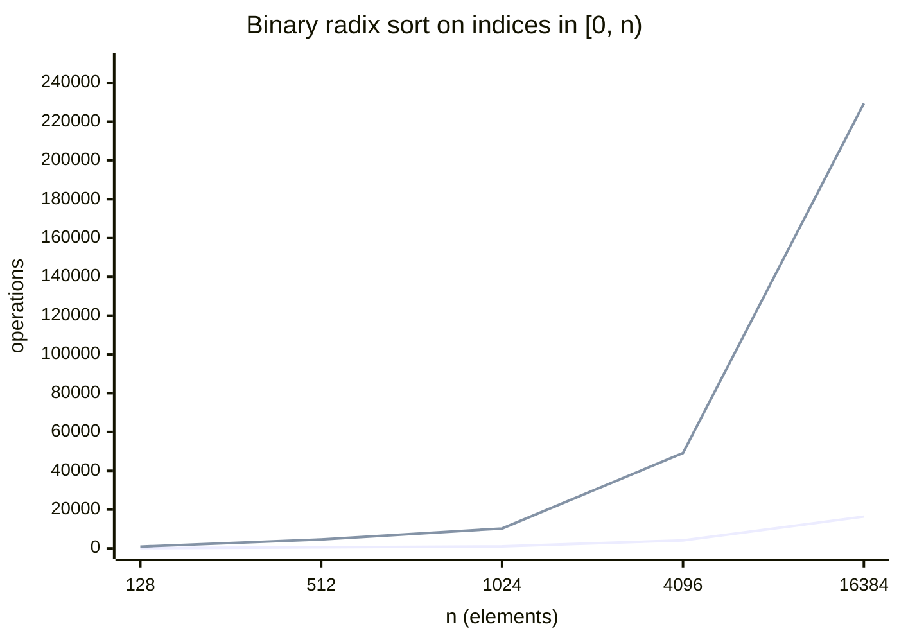

# Binary Radix Sort

> Sources: OpenCode / LongCat 2.5 (AI-generated explanation), 2026-10-21; OpenCode / MiMo-V2.6 Flash (AI-generated explanation), 2026-10-23
> Raw: [binary radix sort](../../raw/algorithms/2026-10-21-binary-radix-sort.md); [why binary radix sort is O(n log n)](../../raw/algorithms/2026-10-23-binary-radix-sort-complexity.md)
> Updated: 2026-10-23

## Overview

Binary radix sort is radix sort with a radix of 2: instead of bucketing elements by a decimal digit, it buckets them by one bit at a time. It fits the two-stack push_swap model especially well, because a stable partition by a single bit can be performed with pushes and rotates alone, with no pairwise comparisons. This article covers the least-significant-digit (LSD) form used on stacks, the most-significant-digit (MSD) recursive form used on arrays, and how to read a single bit with the bitwise shift-and-mask test.

## LSD and MSD

Binary radix sort comes in two flavors:

- **LSD (least-significant-digit)** — process bits from the least-significant to the most-significant, and require every pass to be a **stable** partition by that bit. The classic LSD proof then applies: after processing bits `0..k` the sequence is sorted by those bits, and the final pass leaves it fully sorted. This is the form that maps onto two stacks.
- **MSD (most-significant-digit)** — process bits from the most-significant downward and **recurse on each bucket**. This is essentially quicksort on bits: each level is one `O(n)` partition and there are `ceil(log2(max))` levels, giving `O(n log n)` worst case with no randomization. MSD must recurse on subranges; a single pass over the whole array per bit does not sort, because the next bit's partition would re-mix the groups the previous bit separated.

## Reading a bit with bitwise operators

To test bit `k` of a rank (where `k = 0` is the least-significant bit), shift the rank right by `k` and then mask with `1`:

```text
bit = (rank >> k) & 1
```

- `rank >> k` moves bit `k` down into the units place, dividing by `2^k` and discarding the remainder.
- `& 1` keeps only the lowest bit, so the result is exactly `0` or `1`.

For rank `6` = binary `110`:

| Test | Shifted value | Masked with 1 | Result |
|------|---------------|---------------|--------|
| `(6 >> 0) & 1` | `110` | `110 & 001` | `0` |
| `(6 >> 1) & 1` | `011` | `011 & 001` | `1` |
| `(6 >> 2) & 1` | `001` | `001 & 001` | `1` |

The division and modulo equivalent is `(rank / 2^k) mod 2`, but shift-and-mask is the idiomatic bitwise test and costs a constant number of machine instructions.

## The stable partition primitive

The building block is a **stable partition by one bit**: split the sequence into the `bit == 0` group and the `bit == 1` group, keep the original relative order inside each group, and place all zeros before all ones.

With two stacks, suppose the sequence is in stack `A` (top to bottom):

```text
for each of the n elements:
    if ((value >> k) & 1) == 0:
        pb()          # 0s go to B
    else:
        ra()          # 1s stay in A, rotated to the back

while B is not empty:
    pa()              # 0s come back on top
```

This is stable for two reasons. The 1s that stay in `A` are only ever rotated to the back, so they keep their original relative order at the front of `A`. The 0s pushed onto `B` get reversed, but `pa` pushes them back in reverse again, so they come back in original order. The net result is `[0s in original order][1s in original order]`.

## LSD on two stacks

Putting the pieces together, the two-stack LSD algorithm is:

```text
max_bits = number of bits needed to represent ranks 0 .. n-1

for k from 0 to max_bits-1:
    for i from 0 to n-1:
        if ((a[i].rank >> k) & 1) == 0:
            pb()
        else:
            ra()
    while b is not empty:
        pa()
```

Two details matter for push_swap:

1. **Sort by rank, not raw value.** The input values are arbitrary integers, so first assign each element its rank (`0..n-1` = its position in the sorted order). That is an `O(n^2)` pass — for each element, count how many are smaller — which is acceptable.
2. **Use ranks' bits, not values' bits.** Only `ceil(log2(n))` bits are needed, and ranks are dense, so there are no gaps.

## Worked example

Take bucket `A` starting as `[19, 2, 34, 8, 5, 21, 0]` with `B` empty. First map each value to its rank (its index in the sorted order), then write each rank as a 3-bit binary number, since `ceil(log2(7)) = 3`. In the diagrams below, the left end of a bucket is its top.



The sorted values are `0, 2, 5, 8, 19, 21, 34`, so the rank of a value is its position there. The three bits of each rank are:

| value | rank | 3-bit binary | bit 0 | bit 1 | bit 2 |
|-------|------|--------------|-------|-------|-------|
| 19    | 4    | 100          | 0     | 0     | 1     |
| 2     | 1    | 001          | 1     | 0     | 0     |
| 34    | 6    | 110          | 0     | 1     | 1     |
| 8     | 3    | 011          | 1     | 1     | 0     |
| 5     | 2    | 010          | 0     | 1     | 0     |
| 21    | 5    | 101          | 1     | 0     | 1     |
| 0     | 0    | 000          | 0     | 0     | 0     |

### Pass 0 — test bit 0

Push each element whose bit 0 is `0` into bucket `B` (`pb`); rotate each element whose bit 0 is `1` to the back of `A` (`ra`). Once all seven are processed, drain `B` back onto `A` with `pa`, which restores the `0`-group ahead of the `1`-group.



### Pass 1 — test bit 1

The same procedure, now reading bit 1 of each rank from the bucket produced by pass 0.



### Pass 2 — test bit 2

The last pass, since 3 bits cover all ranks `0..6`. The result is fully sorted.



After pass 2, bucket `A` reads `[0, 2, 5, 8, 19, 21, 34]` — ascending — and `B` is empty. A quick summary of the three passes:

| Pass | Bit tested | bit == 0 group (pushed to B) | bit == 1 group (rotated in A) | A after the pass |
|------|------------|------------------------------|-------------------------------|------------------|
| 0 | bit 0 | 19, 34, 5, 0 | 2, 8, 21 | `[19, 34, 5, 0, 2, 8, 21]` |
| 1 | bit 1 | 19, 0, 2, 21 | 34, 5, 8 | `[19, 0, 2, 21, 34, 5, 8]` |
| 2 | bit 2 | 0, 2, 5, 8 | 19, 21, 34 | `[0, 2, 5, 8, 19, 21, 34]` |

## MSD recursively

The array-based recursive form is:

```text
function msd(elements, hi_bit):
    if hi_bit < 0 or elements is empty:
        return
    zeros = []
    ones = []
    for e in elements:
        if ((e >> hi_bit) & 1) == 0:
            zeros.append(e)
        else:
            ones.append(e)
    msd(zeros, hi_bit - 1)
    msd(ones, hi_bit - 1)
    result = zeros followed by ones
```

## Complexity and trade-offs

| Variant | Time | Extra space | Stable |
|---------|------|-------------|--------|
| LSD binary radix | `O(n * b)`, `b = ceil(log2(n))` | `O(1)` with two stacks | yes |
| MSD binary radix | `O(n * b)` | `O(n)` buckets or `O(b)` recursion depth | yes if the partition is |

For push_swap, `b` is about 9 for `n = 500`, so the sort is on the order of `2 * n * b` stack operations. That is the main attraction: no pairwise comparisons during the sort, just bit tests and pushes.

### Why it is O(n log n)

Since `b = ceil(log2(n))`, the `O(n * b)` bound is really `O(n log n)`. The derivation, for `n` values index-compressed to `[0, n)`:

**Cost of one pass.** You touch every element once — read 1 bit, increment a counter, write the element to a new position. That is `c * n` work for a small constant `c` (about 3 operations per element):

```text
T(1 pass) = c * n          -> Theta(n)
```

**Number of passes.** One per bit. With values in `[0, n)`, the maximum value is `n - 1`, which fits in `ceil(log2(n))` bits:

| n | range | bits needed | passes |
|---|---|---|---|
| 16 | 0–15 | 4 | 4 |
| 1024 | 0–1023 | 10 | 10 |
| 4096 | 0–4095 | 12 | 12 |
| 100 000 | 0–99 999 | 17 | 17 |

**Total:**

```text
T(n) = passes x T(1 pass)
     = ceil(log2(n)) x c * n
     = c * n * log2(n) + c * n          (the + c * n is the last partial bit)
     = Theta(n log n)
```

**Concrete numbers (n = 1024).**

- Radix: 10 passes x 1024 elements x ~3 ops = ~30 720 operations.
- Bubble sort: `n^2` = 1 048 576 comparisons (~34x worse).
- Merge/quick sort: `n * log2(n)` = 10 240 comparisons, but each comparison is an expensive tree-node/pointer/swap operation, while radix's inner loop is just a bit test and a memcpy.

**Why it cannot be O(n).** If the value range were fixed (e.g. raw 32-bit ints), then passes = 32 = a constant, giving `Theta(n)`. But here the bit-width grows with n (`log2(n)`), so it is genuinely `n log n`, not linear.

**Why log n passes is the floor (information theory).** There are `n!` possible orderings, so you need `log2(n!) ~ n * log2(n)` bits of information to determine the answer. Each pass inspects n bits and reveals at most n bits of information about the ordering, so you need at least:

```text
n * log2(n) / n = log2(n) passes (minimum)
```

Binary radix sort on compressed indices therefore exactly meets the information-theoretic bound — same asymptotic class as comparison sorts, but with a much smaller constant because it never builds a comparison tree.

**Growth chart.** Operations vs n for binary radix sort on indices in `[0, n)` — the gap between the lines is the `log2(n)` multiplier, which grows very slowly (7, 9, 10, 12, 14 passes), exactly why radix sort stays fast in practice even though it is technically `O(n log n)`:



## Common gotchas

- **Stability is mandatory.** An unstable partition (for example a plain quicksort-style partition by bit) breaks LSD.
- **Bit direction.** LSD processes the low bit first; MSD processes the high bit first, with recursion.
- **Use dense ranks.** Sorting raw sparse values wastes passes and can need more bits than necessary.
- **Duplicates.** Ranks must be assigned consistently — equal values get equal ranks — or the bit test becomes ambiguous.
- **Reassembly cost.** The `pa` loop is what makes the partition stable; skipping it breaks the algorithm.

## See Also

- [push_swap](../push_swap.md)
