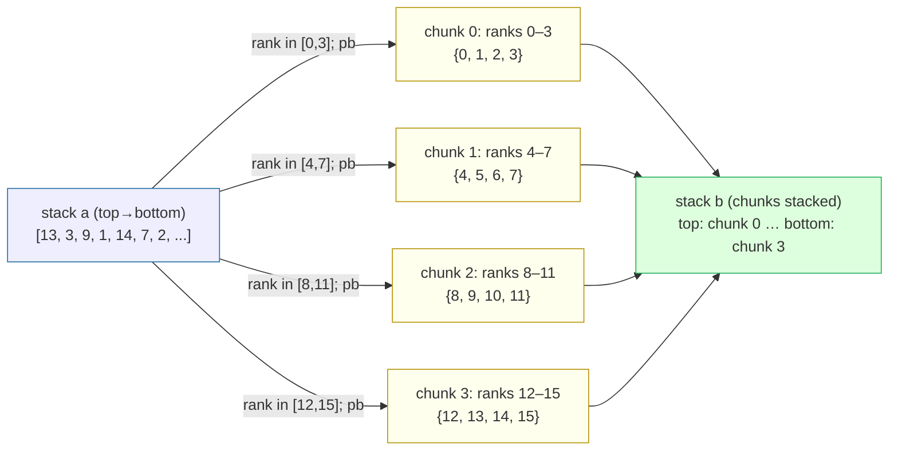
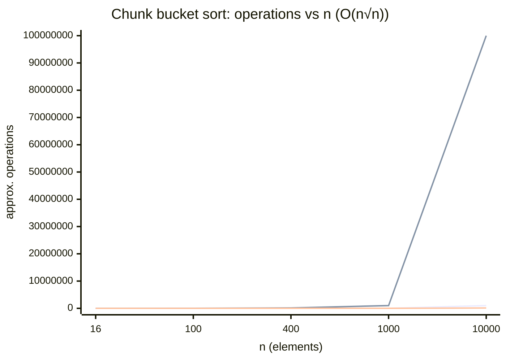

# Bucket Sort — Chunk-Based (O(n√n)) for Push Swap

> Sources: GeeksforGeeks (Sanchhaya Education Private Limited), "Bucket Sort", Last Updated 30 Sep 2025; push_swap project specification (firecrawl, 2026-10-12); chunk-based O(n√n) integer adaptation derived by this wiki, 2026-10-24
> Raw: [bucket sort](../../raw/algorithms/2026-10-24-bucket-sort.md); [push_swap project](../../raw/push-swap-project.md)
> Updated: 2026-10-24

## Overview

Bucket sort distributes elements into buckets, sorts each bucket, then concatenates. Adapted to the push_swap two-stack model and **integer** values, this becomes a **chunk-based block partitioning algorithm**: the value range `[0, n)` is divided into `⌈√n⌉` chunks (buckets) of about `√n` consecutive ranks each. Elements are pushed from stack `a` to stack `b` chunk by chunk (`pb`), positioned inside `b` with rotates (`rb`/`rrb`), and finally moved back to `a` (`pa`) so `a` ends sorted. This matches push_swap's **Medium O(n√n)** strategy tier ("Chunk-based or block-based partitioning methods").

## Bucket operations mapped to push_swap operations

| Bucket operation | push_swap op | Meaning |
|---|---|---|
| Move next chunk element onto stack b | `pb` | Pop from `a`, push onto `b` |
| Rotate stack `a` to bring a target chunk element to top | `ra` / `rra` | Bring the next element of the current chunk to the top of `a` before `pb` |
| Position inside stack `b` so the chunk stays sorted | `rb` / `rrb` | Rotate `b` so the newly pushed element lands in its sorted position within the chunk |
| Swap top two of `a` or `b` | `sa` / `sb` | Fix adjacent order within a chunk |
| Move a finished chunk back to `a` | `pa` | Pop from `b`, push onto `a` (chunks return in reverse chunk order so `a` ends ascending) |

These are exactly the operations listed in push_swap's key concepts: `sa, sb, ss, pa, pb, ra, rb, rr, rra, rrb, rrr`.

## Algorithm (pseudocode, integer ranks 0 .. n-1)

```text
chunkSort(a):
    n = size(a)
    c = ceil(sqrt(n))            # chunk size
    m = ceil(n / c)              # number of chunks (~ sqrt(n))

    # Phase 1: distribute chunk by chunk
    for chunk = 0 .. m-1:
        lo = chunk * c
        hi = min((chunk + 1) * c, n) - 1
        # bring every element whose rank is in [lo, hi] to the top of a and pb to b
        for each rank r in [lo, hi] (ascending):
            rotate a (ra / rra) until the element of rank r is on top
            pb                              # a -> b
            rotate b (rb / rrb) as needed   # keep the chunk ordered inside b

    # Phase 2: gather — chunks were pushed in ascending chunk order,
    # so popping them back with pa yields an ascending stack a
    while b not empty:
        pa                              # b -> a
```

## Worked example — integers, n = 16, √n = 4

Stack `a` (top → bottom): `[13, 3, 9, 1, 14, 7, 2, 11, 5, 0, 15, 8, 4, 10, 6, 12]`
Ranks equal the values (already compressed to 0..15). Four chunks of 4:
- chunk 0: ranks 0–3 → values `{0, 1, 2, 3}`
- chunk 1: ranks 4–7 → values `{4, 5, 6, 7}`
- chunk 2: ranks 8–11 → values `{8, 9, 10, 11}`
- chunk 3: ranks 12–15 → values `{12, 13, 14, 15}`

Distribution table (chunk = rank / 4):

| value | rank | chunk | op to move to b |
|---|---|---|---|
| 13 | 13 | 3 | rotate `a`, `pb` |
| 3 | 3 | 0 | rotate `a`, `pb` |
| 9 | 9 | 2 | rotate `a`, `pb` |
| 1 | 1 | 0 | rotate `a`, `pb` |
| 14 | 14 | 3 | rotate `a`, `pb` |
| 7 | 7 | 1 | rotate `a`, `pb` |
| 2 | 2 | 0 | rotate `a`, `pb` |
| 11 | 11 | 2 | rotate `a`, `pb` |
| 5 | 5 | 1 | rotate `a`, `pb` |
| 0 | 0 | 0 | rotate `a`, `pb` |
| 15 | 15 | 3 | rotate `a`, `pb` |
| 8 | 8 | 2 | rotate `a`, `pb` |
| 4 | 4 | 1 | rotate `a`, `pb` |
| 10 | 10 | 2 | rotate `a`, `pb` |
| 6 | 6 | 1 | rotate `a`, `pb` |
| 12 | 12 | 3 | rotate `a`, `pb` |

### Mermaid — distribution into chunks



Within each chunk, elements are inserted in sorted position using `rb`/`rrb` (and `sb` for adjacent swaps). The final gather with `pa` returns the chunks to `a` so `a` reads `[0, 1, 2, 3, 4, 5, 6, 7, 8, 9, 10, 11, 12, 13, 14, 15]`.

## Complexity — why O(n√n)

Let `n` = number of elements, `c = ⌈√n⌉` chunk size, `m = ⌈n/c⌉ ≈ √n` chunks.

| Phase | Operations | Cost |
|---|---|---|
| Distribution | each of n elements pushed once with `pb`, plus `ra`/`rra` scans | O(n) |
| In-chunk placement | m chunks × insertion into a chunk of ≤ c elements | m × O(c²) |
| Gather | n elements popped back with `pa` | O(n) |

Since `c = √n` and `m = √n`:

```
in-chunk cost = m × O(c²) = √n × O((√n)²) = √n × O(n) = O(n√n)
total          = O(n) + O(n√n) + O(n) = O(n√n)
```

Concrete calculation (`n = 100`, `c = 10`, `m = 10`):

| Phase | Op count (approx.) |
|---|---|
| Distribution | 100 `pb` + rotations ≈ O(n) |
| In-chunk sort | 10 chunks × ~10²/2 ≈ 500 compare/swap ops ≈ O(√n · n) |
| Gather | 100 `pa` ≈ O(n) |
| **Total** | **~O(n√n) ≈ 1000–1500 ops** |

This lands in push_swap's medium tier: for 100 numbers the project expects <2000 operations minimum, and an O(n√n) chunk sort sits right around that scale.

### Mermaid — operation growth



The O(n√n) curve stays far below O(n²) as n grows, while remaining above O(n log n) — exactly the medium strategy push_swap selects for mid-sized inputs.

## See Also

- [push_swap](../push_swap.md) — Medium O(n√n) tier = chunk-based/block-based partitioning; operations sa, sb, ss, pa, pb, ra, rb, rr, rra, rrb, rrr
- [Big O Notation](big-o-notation.md) — O-notation definition and the sum/product rules used in this derivation
- [Binary Radix Sort](binary-radix-sort.md) — the Complex O(n log n) tier on the same two-stack model
