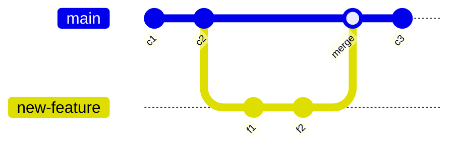
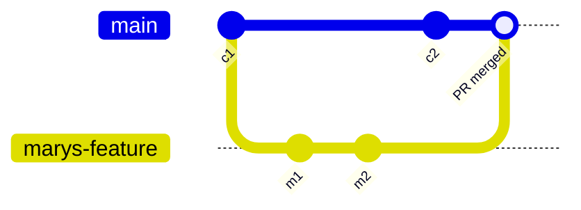
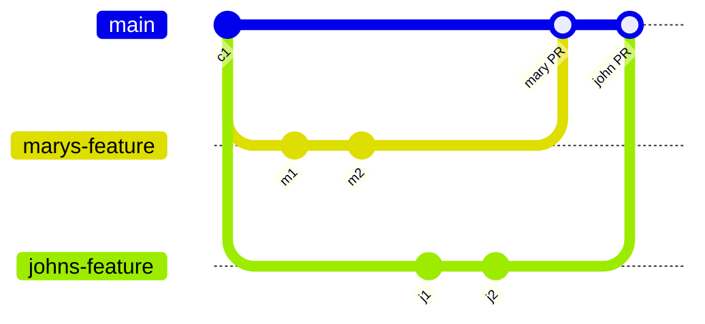

# Git Feature Branch Workflow

> Sources: Atlassian, Unknown; local notes, Unknown
> Raw: [Git feature branch workflow](../../raw/git/feature-branch-workflow.md); [Method 1: Merge Locally and Push (Fastest)](../../raw/git/merge-to-main-local.md)
> Updated: 2026-10-20

## Overview

The Feature Branch Workflow is a Git branching model where all feature development happens in a dedicated branch instead of `main`. Encapsulating features lets multiple developers work in parallel without disturbing the main codebase, and `main` never contains broken code — a major advantage for continuous integration environments. Feature branches also enable pull requests: discussions around a branch where teammates review, sign off, or request changes before integration. The model is branch-focused and composable — Gitflow and the Git Forking Workflow build their branching models on top of it.

## How It Works

The workflow assumes a central repository where `main` holds the official project history. Developers never commit directly to local `main`; each new feature gets its own branch with a descriptive name like `animated-menu-items` or `issue-#1061`. Git makes no technical distinction between `main` and feature branches, so normal edit/stage/commit work applies. Feature branches can and should be pushed to the central repository — sharing a feature without touching official code, and backing up everybody's local commits.



### Branch Lifecycle

1. **Start from `main`** — sync with the latest official state:
   ```bash
   git checkout main
   git fetch origin
   git reset --hard origin/main
   ```
2. **Create a feature branch** — `-b` creates the branch if it doesn't exist:
   ```bash
   git checkout -b new-feature
   ```
3. **Develop** — edit, stage, and commit as usual:
   ```bash
   git status
   git add <some-file>
   git commit
   ```
4. **Push the feature branch** — `-u` sets up remote tracking, after which plain `git push` works:
   ```bash
   git push -u origin new-feature
   ```
5. **Resolve feedback** — teammates comment and approve on the pull request; fix locally, commit, push again. Updates appear in the pull request.
6. **Merge** — resolve any merge conflicts first; once approved and conflict-free, merge the pull request into `main`.

## Pull Requests

Branches make it possible to discuss changes via pull requests. Instead of merging into `main` immediately, the developer pushes the feature branch and files a pull request asking to merge it into `main` — giving everyone a chance to review before the change becomes part of the main codebase. Pull requests double as a generic discussion mechanism: file one early to ask for help, and interested parties are notified automatically with the question visible next to the relevant commits. Once accepted, publishing means syncing local `main` with upstream, merging the feature branch in, and pushing the updated `main` back to the central repository. Source code management tools like Bitbucket Cloud facilitate pull requests.

## Worked Example: Mary and Bill

Mary starts a feature on an isolated branch, `git checkout -b marys-feature main`, and builds it with normal `git add` / `git commit` cycles. Before lunch she pushes with `git push -u origin marys-feature` as a backup and for collaborator access. After finishing, she runs plain `git push`, then files a pull request to merge `marys-feature` into `main`. Bill reviews, requests changes, and Mary iterates with the same edit/commit/push flow — all visible in the pull request. Bill could also pull `marys-feature` locally; his commits would appear there too. When Bill accepts, either of them publishes:



```bash
git checkout main
git pull
git pull origin marys-feature
git push
```

This usually yields a merge commit — a symbolic joining of the feature with the codebase. Preferring linear history? Rebase the feature onto the tip of `main` before merging for a fast-forward merge. Many GUIs automate pull request acceptance with a single "Accept" click, and should at least auto-close the pull request once merged. Meanwhile John does exactly the same thing on his own feature branch — isolation keeps everyone independent while sharing stays trivial.



## Merging Locally Without a Pull Request

The pull request path above assumes review is required. When you have direct write access to `main` and no code review is needed, merging locally is the fastest route: commit on the feature branch, switch to `main`, pull the latest remote state, merge the feature branch in, and push.

```bash
git add .
git commit -m "Your commit message"
git checkout main
git pull origin main
git merge <your-branch-name>
git push origin main
```

Order matters: pulling `origin/main` before merging keeps `main` up to date, so the merge applies against the latest official history. Unlike the pull request flow, this publishes directly to `main` with no review gate — only appropriate when direct write access is sanctioned.

## Summary

- Focused on branching patterns
- Can be leveraged by other repo-oriented workflows (Gitflow, Git Forking)
- Promotes collaboration through pull requests and merge reviews
- Using `git rebase` during review and merge enforces a cohesive Git history of feature merges
